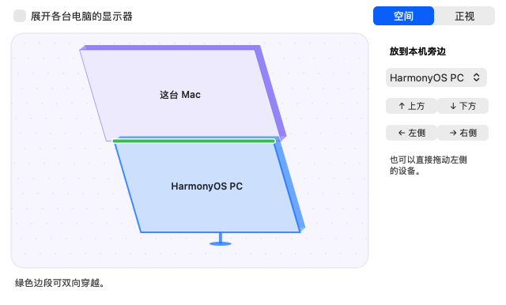

# Hop · One keyboard and mouse across your computers

[中文](README.md)

Hop shares a keyboard and mouse between computers on the same local network. The keyboard and mouse stay plugged into the host computer; push the pointer across a screen edge to control the computer next to it. Devices connect to each other directly. There is no Hop account and no cloud service.

[Download the v2.0.0-rc.2 preview](https://github.com/Mydstiny/hop/releases/tag/v2.0.0-rc.2)

## Downloads and supported platforms

The **v2.0.0-rc.2** preview supports the four platforms below. Use the same version on every computer you pair.

| Platform | Roles in the preview | Installer and requirements |
| --- | --- | --- |
| macOS 14 or later | Share input, receive input | Universal DMG for Apple silicon and Intel, with a ZIP as a fallback. The preview build is ad-hoc signed; Apple notarization is pending. |
| Windows 10 x64 (build 15063 or later), Windows 11 x64 | Share input, receive input | Per-user EXE installer. The preview build is not Authenticode signed yet. |
| HarmonyOS PC / 2-in-1, API 20+, arm64 | Receive input | A HAP that you sign and sideload yourself. Use the input-only build with an ordinary debug profile, or the full build with a profile that carries the clipboard ACL. |
| Ubuntu 22.04 / 24.04 amd64, X11 session | Share input, receive input | A DEB package; install it with `sudo apt install ./FILE`. Needs an unlocked keyring. Wayland sessions are not supported yet, and the package has not yet been accepted on real input devices. |

The release page provides `SHA256SUMS`. After downloading, check a file with `shasum -a 256 FILE` (macOS) or `Get-FileHash -Algorithm SHA256 FILE` (PowerShell) or `sha256sum FILE` (Linux).

## Install and permissions

- **macOS.** Open the DMG and drag Hop to Applications. With the ZIP, unzip it and move `Hop.app` to Applications. Open Hop from the menu bar and grant Accessibility and Input Monitoring in System Settings → Privacy & Security, then reopen Hop when prompted. Gatekeeper may restrict a downloaded preview build. [Install and permissions](docs/INSTALL_MAC.md) · [Apple's Gatekeeper article](https://support.apple.com/en-us/102445)
- **Windows.** Run the EXE, open Hop from the Start menu and use the Hop icon in the system tray to reach the panel. LAN pairing needs TCP connections between the computers to be allowed. An unsigned build may trigger a SmartScreen prompt or be blocked by organisation policy. [Install notes](apps/windows/installer/README.md) · [Microsoft's SmartScreen article](https://learn.microsoft.com/en-us/windows/apps/package-and-deploy/smartscreen-reputation)
- **HarmonyOS PC.** Create a debug profile for the bundle name `dev.hop.input` that includes the target device, sign the HAP and sideload it with DevEco or HDC. Open Hop from the top bar and allow input control and background running when asked. The build with text and image sync needs a profile that includes `ohos.permission.READ_PASTEBOARD`, plus the matching system permission. [Signing and sideloading](docs/INSTALL_HARMONYOS.md)
- **Linux.** In an X11 session, run `sudo apt install ./Hop-2.0.0-rc.2-linux-amd64.deb`, then open Hop from the application menu or run `hop-input`. Device certificates are kept in the system keyring, which must be unlocked. Local discovery uses Avahi; you can also enter an address and port 24891 by hand. The emergency shortcut is **Ctrl+Alt+Shift+Esc**. Remove it with `sudo apt remove hop-input`. [Linux notes](apps/linux/README.md)

## First pairing and crossing

1. Put both computers on the same local network. On the computer with the keyboard and mouse, open Hop, choose **Share input**, then **Add computer…** to start pairing. On the other computer choose **Receive input** and connect to the host from the device list. On a HarmonyOS PC, pick the host directly in the Hop panel in the top bar.
2. Compare the full fingerprints shown on both sides and confirm on each side only when they match. If the device is not discovered, enter the host's LAN address and port by hand on the receiver. The default port is **24891**.
3. Arrange devices and displays on the host so that the edges of neighbouring screens touch. In the Mac's spatial layout you can drag a device, or click up, down, left or right to snap it. Green lines are the edge segments the pointer can actually cross.
4. Start sharing, release all keys and buttons, and push the pointer across a touching edge. For example, with the HarmonyOS PC below the Mac, leave through the Mac's bottom edge and come back through the HarmonyOS PC's top edge. Pause sharing to stop controlling. The emergency stop on the Mac is **Control + Option + Command + Esc**.

## Keyboard, mouse and clipboard

- Shortcuts are translated to the target system's conventions. When a Mac controls Windows or HarmonyOS, for example, Command+C becomes the target's copy shortcut. Text input and input methods are handled by the target computer.
- Pointer sensitivity, scroll speed and scroll direction can be set per target device. Pointer speed is a software multiplier; real hardware DPI depends on the mouse itself.
- When both sides enable sync, text and images are synchronised only between the host and the device currently being controlled. It is on by default on the Mac and on the HarmonyOS full build with clipboard authorisation, and can be turned off in settings. Windows checks its tray setting before connecting. Files are not synchronised.
- After the fingerprints are checked at first pairing, v2 uses mutual TLS to authenticate the devices and encrypt the session. The user chooses which computer is the host.

## Troubleshooting

- **The host is not found.** Make sure both computers are on the same local network and the host has pairing open. Device isolation on guest Wi-Fi can block the connection. You can enter the host's address by hand.
- **The pointer crosses over but cannot come back.** Update both sides and reopen the layout to check that the edges touch. With the Mac above the HarmonyOS PC, the way back is the HarmonyOS PC's top edge. Move the pointer to the position that matches a green segment and push outward. [Four-direction acceptance steps](docs/ACCEPTANCE_UI2.md)
- **Clipboard is on but nothing syncs.** Check the switch and the system permission on both sides, reconnect, and cross again. The HarmonyOS input-only build has no clipboard authorisation; use the full build with the ACL.

## Building from source

| Component | How to build |
| --- | --- |
| Shared protocol and tests | `cmake -S core -B build/core -DBUILD_TESTING=ON`, then `cmake --build build/core` and `ctest --test-dir build/core --output-on-failure`. [Core notes](core/README.md) |
| macOS | Install the Xcode command line tools, CMake and Python 3. Run `bash apps/macos/scripts/package.sh` to build a universal test package. [Mac build notes](docs/INSTALL_MAC.md) |
| Windows | Use an x64 C++17 toolchain and CMake with `HOP_WINDOWS_EXPERIMENTAL_TLS` enabled. Build the installer with NSIS. [Windows build and packaging](apps/windows/installer/README.md) |
| HarmonyOS PC | Install DevEco Studio with the desktop extension and the HarmonyOS SDK. Run `bash apps/harmonyos/scripts/package-unsigned.sh full` for the full build, or pass `input-only` for the input-only build. [HarmonyOS build notes](docs/INSTALL_HARMONYOS.md) |
| Linux X11 | Install CMake, g++ and dpkg-dev. Run `bash apps/linux/scripts/build-native.sh /abs/new-dir` to build the runtimes, then package them with `apps/linux/packaging/build_deb.py`. [Linux build notes](apps/linux/README.md) |

Please report problems and feature requests in [GitHub Issues](https://github.com/Mydstiny/hop/issues). For crossing problems, include the OS versions of the host and receiver, their relative positions and the edge that fails.

The earlier two-device v1 is documented in the [v1 README](README.v1.en.md). Hop is released under the [MIT license](LICENSE). Dependency licenses are listed in the [third-party notices](THIRD_PARTY_NOTICES.md).
