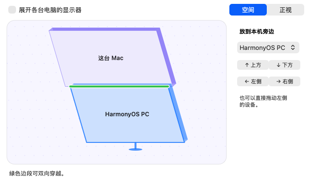

# Hop · 一套键鼠，穿越多台电脑

Hop 在同一局域网内共享键盘和鼠标。键鼠接在主控电脑上，把鼠标推过屏幕边缘，就能操作旁边的电脑。设备直接连接，无需 Hop 账号或云服务。

[下载 v2.0.0-rc.1 预览版](https://github.com/Mydstiny/hop/releases/tag/v2.0.0-rc.1)

## 下载与支持范围

**v2.0.0-rc.1** 预览版支持下表中的三个平台。请在所有参与配对的电脑上使用同一版本。

| 平台 | 预览版角色 | 安装文件与条件 |
| --- | --- | --- |
| macOS 14 或更新版本 | 共享键鼠、接收键鼠 | 通用 DMG，包含 Apple 芯片和 Intel 架构。另有 ZIP 备用。当前预览构建使用临时签名，Apple 公证待完成。 |
| Windows 10 x64（15063 或更新内部版本）、Windows 11 x64 | 共享键鼠、接收键鼠 | 面向当前用户的 EXE 安装程序。当前预览构建尚未做 Authenticode 签名。 |
| HarmonyOS PC / 二合一，API 20+，arm64 | 接收键鼠 | 用户自行签名侧载的 HAP。有普通调试 Profile 时使用键鼠版，有剪贴板 ACL 的 Profile 时可使用完整版。 |

版本页提供 `SHA256SUMS`。下载后可用 `shasum -a 256 文件名`（macOS）或 `Get-FileHash -Algorithm SHA256 文件名`（PowerShell）核对。Linux X11 客户端源码在仓库内，当前三端预览版未附 Linux 安装包。

## 安装和权限

- **macOS。** 打开 DMG，把 Hop 拖到「应用程序」。使用 ZIP 时，解压后把 `Hop.app` 移入「应用程序」。打开菜单栏的 Hop，在系统「隐私与安全性」中授予「辅助功能」和「输入监控」。按系统提示重开 Hop。下载的预览构建可能受 Gatekeeper 限制。[安装与权限](docs/INSTALL_MAC.md) · [Apple 的 Gatekeeper 说明](https://support.apple.com/en-us/102445)
- **Windows。** 运行 EXE 后从开始菜单打开 Hop，使用系统托盘里的 Hop 图标进入面板。局域网配对需允许电脑之间建立 TCP 连接。未签名构建可能触发 SmartScreen 提示或受到组织策略限制。[安装说明](apps/windows/installer/README.md) · [Microsoft 的 SmartScreen 说明](https://learn.microsoft.com/en-us/windows/apps/package-and-deploy/smartscreen-reputation)
- **HarmonyOS PC。** 为包名 `dev.hop.input` 配置包含目标设备的调试 Profile，签名后通过 DevEco 或 HDC 侧载。从顶栏打开 Hop，按提示允许键鼠控制和后台运行。带文本、图片同步的版本需要 Profile 包含 `ohos.permission.READ_PASTEBOARD`，并在系统中授予权限。[签名与侧载步骤](docs/INSTALL_HARMONYOS.md)

## 第一次配对与跨屏

1. 把两台电脑连到同一局域网。在接着键鼠的电脑上打开 Hop，选择「共享键鼠」，再点「添加电脑」进入配对。在另一台电脑选择「接收键鼠」，从设备列表连接主控端。鸿蒙 PC 在顶栏的 Hop 面板里直接选择主控电脑。
2. 对照两端显示的完整指纹，两边一致后分别确认。找不到设备时，可在接收端手动填写主控电脑的局域网地址和端口，默认端口为 **24891**。
3. 在主控端排列设备和显示器，使代表相邻屏幕的边缘贴合。Mac 的「空间布局」里可以拖动设备，也可以点上、下、左、右快速贴合。绿线对应实际可穿越的边段。
4. 开始共享，松开键鼠后把鼠标推过相接的边缘。例如鸿蒙位于 Mac 下方时，从 Mac 底边过去，从鸿蒙顶边回来。需要结束控制时，可以暂停共享。Mac 的紧急停止快捷键为 **Control + Option + Command + Esc**。

## 键鼠与剪贴板

- 快捷键按目标系统习惯转换。例如 Mac 控制 Windows 或鸿蒙时，Command+C 对应目标系统的复制快捷键。文字与输入法由目标电脑处理。
- 指针灵敏度、滚动速度和方向可以按目标设备调整。指针倍率通过软件调节，实际硬件 DPI 与鼠标本身有关。
- 两端启用同步后，文本和图片只在主控端与当前正在控制的设备间同步。Mac 和具备剪贴板授权的鸿蒙完整版默认开启，可在设置中关闭。Windows 在连接前检查其托盘设置。文件不在同步范围内。
- 首次配对核对指纹后，v2 使用双向 TLS 验证设备身份和加密会话。主控角色由用户选择。

## 常见问题

- **搜不到主控。** 确认两台电脑处在同一局域网，主控已开启配对。访客 Wi‑Fi 的设备隔离可能阻止连接。可以手动填写主控端地址。
- **能过去但回不来。** 更新两端，重新打开布局核对边缘贴合。Mac 位于鸿蒙上方时，回程边缘是鸿蒙的顶边。把鼠标移到绿色边段对应的位置后向外推。[四向验收步骤](docs/ACCEPTANCE_UI2.md)
- **剪贴板开着却不同步。** 检查两端开关及系统授权，重新建立连接后跨屏。鸿蒙键鼠版不包含剪贴板授权能力，需要使用包含 ACL 的完整版。

## 从源码构建

| 组件 | 构建方式 |
| --- | --- |
| 共享协议与测试 | `cmake -S core -B build/core -DBUILD_TESTING=ON`，随后运行 `cmake --build build/core` 和 `ctest --test-dir build/core --output-on-failure`。[核心说明](core/README.md) |
| macOS | 安装 Xcode 命令行工具、CMake 和 Python 3。运行 `bash apps/macos/scripts/package.sh` 构建通用测试包。[Mac 构建说明](docs/INSTALL_MAC.md) |
| Windows | 使用 x64 C++17 工具链和 CMake，启用 `HOP_WINDOWS_EXPERIMENTAL_TLS` 后构建。用 NSIS 生成安装包。[Windows 构建与打包](apps/windows/installer/README.md) |
| HarmonyOS PC | 安装带桌面扩展的 DevEco Studio 和 HarmonyOS SDK。运行 `bash apps/harmonyos/scripts/package-unsigned.sh full` 生成完整版，或使用 `input-only` 生成键鼠版。[鸿蒙构建说明](docs/INSTALL_HARMONYOS.md) |
| Linux X11 | GTK 客户端和 X11 捕获后端。[Linux 构建说明](apps/linux/README.md) |

问题和功能建议请提交到 [GitHub Issues](https://github.com/Mydstiny/hop/issues)。涉及跨屏时，请注明主控与接收端的系统版本、相对位置和出问题的边缘。

Hop 采用 [MIT 许可证](LICENSE)。依赖许可见 [第三方声明](THIRD_PARTY_NOTICES.md)。
